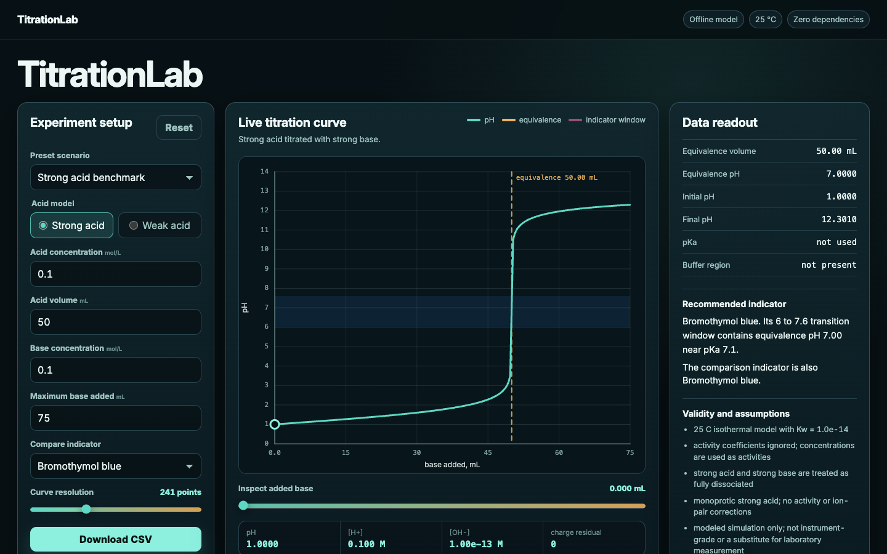
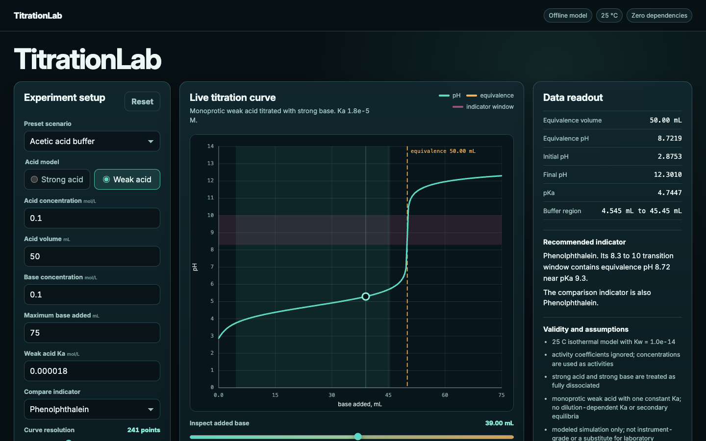
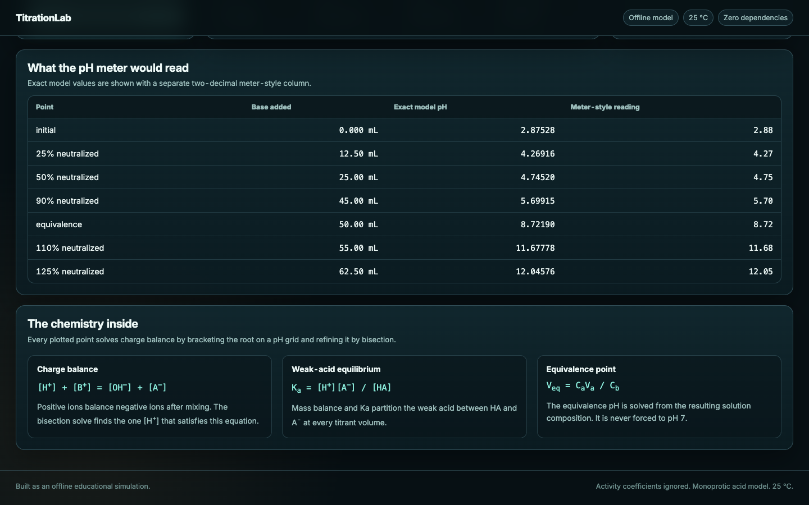

# TitrationLab

TitrationLab is an offline acid-base titration workbench built as a single static page. It models strong-acid/strong-base and monoprotic weak-acid/strong-base titrations with charge-balance chemistry, a live canvas chart, exact data readouts, a meter-style table, and indicator selection guidance.

This repository was built fresh during the STEM Innovation Challenge work window of November 23-25, 2026. It does not reuse an earlier titration project.

## Run it

No install step, dependencies, keys, accounts, or network access are needed.

```bash
open index.html
```

Or serve it locally with Node 22 or newer.

```bash
node scripts/serve.mjs 4173
# then open http://127.0.0.1:4173/
```

## Test it

Requires Node 22 or newer.

```bash
npm test
```

The suite has 10 deterministic `node:test` cases with 73 assertion statements. The checks cover strong-acid/strong-base hand-computed excess-acid and excess-base points, the weak-acid initial quadratic, the Henderson-Hasselbalch buffer region, conjugate-base hydrolysis at equivalence, exact charge-balance residuals, indicator transition windows, input validation, meter rounding, and monotonic chart data.

## Chemistry model

The model uses concentrations in mol/L and volumes in mL. The titrant is a monoprotic strong base represented by its positive counterion concentration. At every added volume `Vb`, the total volume is `Vt = Va + Vb`.

For a strong acid and strong base, charge balance is

```text
h + CbVb/Vt = Kw/h + CaVa/Vt
```

For a monoprotic weak acid titrated with strong base, total weak-acid species are

```text
Ct = CaVa/Vt
[A-] = CtKa/(h + Ka)
```

and charge balance is

```text
h + CbVb/Vt = Kw/h + CtKa/(h + Ka)
```

The app scans a pH grid from -2 to 16 in 0.05 pH steps until the charge-balance residual changes sign, then refines that bracket by 100 bisection iterations. The function is monotonic over the supported input range, so the bracketed positive root is unique.

The stoichiometric equivalence volume is

```text
Veq = CaVa/Cb
```

The equivalence pH is computed by solving the same charge-balance equation at `Veq`. For a weak acid this captures the basic solution produced by conjugate-base hydrolysis rather than forcing pH 7. For the acetic-acid preset (`Ca = 0.1 M`, `Va = 50 mL`, `Cb = 0.1 M`, `Ka = 1.8e-5`) the solved equivalence point is pH 8.7219, close to the hand hydrolysis estimate of about 8.72.

The weak-acid buffer shading runs from 1/11 to 10/11 of the equivalence volume. Those fractions correspond to Henderson-Hasselbalch ratios of 0.1 and 10, approximately `pKa - 1` through `pKa + 1`.

## Indicator logic

Indicators are compared by their tabulated transition windows and pKa values.

| Indicator | Window | pKa |
| --- | ---: | ---: |
| Methyl orange | 3.1 to 4.4 | 3.7 |
| Methyl red | 4.4 to 6.2 | 5.1 |
| Bromothymol blue | 6.0 to 7.6 | 7.1 |
| Phenolphthalein | 8.3 to 10.0 | 9.3 |

The recommendation is the tabulated indicator whose window contains the solved equivalence pH, preferring the closest pKa when more than one contains it. If none contains it, the app says that the nearest choice is outside its window rather than hiding the mismatch.

## Honest limits

TitrationLab is a modeled educational simulation only. It is not instrument-grade and is not a substitute for laboratory measurement.

The interface explicitly states these assumptions and dynamic warnings.

- 25 °C isothermal model with `Kw = 1.0e-14`
- activity coefficients ignored, so concentrations are used as activities
- strong acid and strong base treated as fully dissociated
- one monoprotic weak acid with one constant Ka
- no secondary equilibria, ion pairing, temperature correction, junction potential, electrode drift, or carbon dioxide uptake
- dilute-input warning when water autoionization materially shapes the result
- warning when a plotted titrant range stops before equivalence

Supported validated inputs are concentrations from `1e-6` to `2 M`, analyte volumes from 1 to 500 mL, titrant ranges from 1 to 1000 mL, weak-acid Ka values from `1e-12` to `1e-1`, and 41 to 2001 curve points.

## Project structure

```text
index.html              static workbench page
styles.css              offline interface styling
app.js                  browser state, canvas chart, readouts, CSV export
solver.js               dependency-free chemistry and numerical solver
tests/titration.test.js deterministic node:test suite
scripts/serve.mjs       tiny local static server
scripts/screenshots.mjs three-image 1440x900 headless-Chrome capture
scripts/synth_narration.py local OmniVoice sentence synthesis
scripts/process_narration.py narration tempo scaling and manifest retiming
scripts/upload_youtube.mjs headless YouTube upload helper
assets/                 real generated screenshots
video/                  narration, capture steps, and demo video artifacts
```

## Screenshots







## Equation references

The equations are standard acid-base equilibrium and titration relations.

- OpenStax, *Chemistry 2e*, Chapter 14, Acid-Base Equilibria.
- Harris and Lucy, *Quantitative Chemical Analysis*, acid-base equilibrium and titration chapters.
- IUPAC, *Compendium of Chemical Terminology*, entries for pH and acid dissociation constant.

## AI-assistance disclosure

AI coding assistants were used during implementation, debugging, test design, documentation, and video-production scripting. The chemistry model, numerical outputs, tests, and final claims were checked against independent hand calculations and deterministic automated tests. Local voice synthesis was used for narration in the demo video.

## License

MIT. See [LICENSE](LICENSE).
